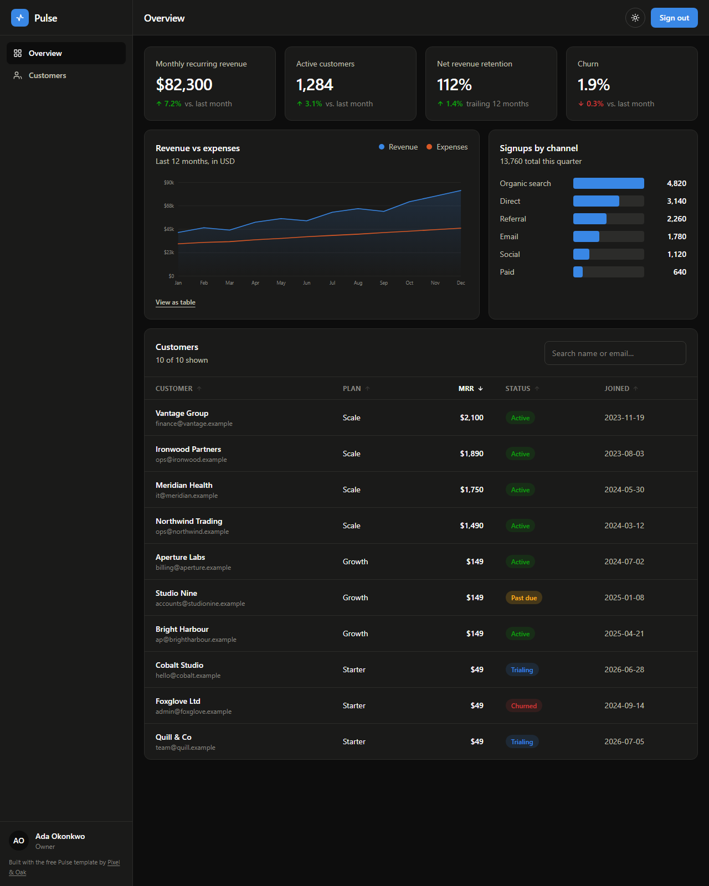

# 📊 Pulse — Free React Admin Dashboard Template

**A production-ready admin dashboard built with Next.js 15, TypeScript, and Tailwind CSS v4.** Charts with no chart library, a sortable data table, an auth shell, and a dark mode that was designed rather than inverted.

**[Live demo →](https://pixelandoak-pulse.pages.dev)**
**[Template page →](https://pixelandoak.com/templates/react-dashboard-template/)**



## Charts with zero dependencies

Most dashboard templates pull in Recharts, Chart.js, or D3 — 40–120kB of JavaScript to draw a line. Pulse draws its charts as SVG paths computed from the data. **No chart library. Total JS for the whole dashboard: ~109kB including React.**

You get a real chart, not a compromise:

- **Crosshair + tooltip** on hover, with values for both series
- **Legend** always present for two or more series, so colour is never the only channel carrying meaning
- **`<table>` fallback** behind a "View as table" toggle — the data is reachable without seeing the chart
- **Recessive grid**, 2px strokes, 8px markers with a surface ring so they stay legible over the line

## The colours are validated, not chosen by eye

This is the part almost every template gets wrong. The two series hues were checked against a colour-vision-deficiency model and a contrast model **before** being used, in both light and dark mode:

| Check | Light | Dark |
| --- | --- | --- |
| CVD separation (protan) | ΔE 24.7 | ΔE 26.8 |
| Normal-vision separation | ΔE 33.6 | ΔE 31.8 |
| Contrast vs surface | ≥ 3:1 ✅ | ≥ 3:1 ✅ |

Roughly 1 in 12 men has some form of colour blindness. A blue/orange pair that clears these thresholds is readable by all of them; the red/green pair most dashboards ship with is not.

**Dark mode is selected, not flipped.** The dark series colours are different hex values (`#3987e5` / `#d95926`), re-stepped for the dark surface — not the light colours shown on a dark background, which is what an automatic inversion gives you and why so many dark dashboards look muddy.

If you change `--series-1` or `--series-2` in `app/globals.css`, re-validate the pair rather than trusting your eye.

## Everything else

- 📐 **App shell** — sidebar + topbar, collapsing to an overlay drawer below `lg` (the layout most admin templates get wrong on phones)
- 🔢 **Sortable, searchable table** — `aria-sort` announced to screen readers, wide tables scroll in their own container so the page never scrolls sideways
- 🔐 **Auth shell** — a real login UI, honestly labelled as UI-only. See below
- 🏷️ **Status badges** — colour *and* text, never colour alone; status hues are reserved and can't be mistaken for a data series
- 📈 **Stat tiles** — deltas ship an arrow glyph plus a screen-reader label, so direction never depends on red vs green
- 🌙 **Real dark mode** — class strategy, localStorage, OS detection, no flash
- 📦 **Static export** — deploys free to any static host

## A note on the login page

`components/LoginForm.tsx` is a UI shell **on purpose**. This template is a static export: it cannot verify a password, and a login screen that appears to authenticate but doesn't is worse than none at all.

Wire `handleSubmit` to Auth.js, Clerk, or Supabase Auth. And when you do: if you add real sessions, move the protected routes off `output: "export"` — a client-side redirect is not access control, it is a speed bump.

## Quick start

```bash
git clone https://github.com/haider484991/pulse-nextjs-dashboard-template.git my-dashboard
```

```bash
cd my-dashboard && npm install && npm run dev
```

Open [http://localhost:3000](http://localhost:3000).

## Make it yours

Product name, navigation, and the signed-in user live in **`config/site.ts`**. All chart and table data lives in **`lib/data.ts`**, typed:

```ts
export type Point = { label: string; revenue: number; expenses: number };
export const monthly: Point[] = [
  { label: "Jan", revenue: 42_000, expenses: 31_000 },
  // …
];
```

Every component is typed against those shapes, so swapping the mock data for your API is a one-file change.

To add a page: create `app/<route>/page.tsx`, wrap it in `<Shell current="/<route>/" title="…">`, and add an entry to `siteConfig.nav`.

## Deploy

```bash
npm run build
```

Emits `/out`:

```bash
npx wrangler pages deploy out
```

Netlify, Vercel, GitHub Pages, and any static host work identically.

## Tech

Next.js 15 (App Router, static export) · React 19 · TypeScript · Tailwind CSS v4 · **no chart library, no table library, no UI library.**

## License

MIT — free for personal and commercial use. Attribution appreciated but not required.

---

Built by [Pixel & Oak](https://pixelandoak.com/templates/react-dashboard-template/) — web design and AI development studio.
More free templates: [Nova (blog)](https://github.com/haider484991/nova-nextjs-blog-template) · [LaunchPad (SaaS)](https://github.com/haider484991/launchpad-nextjs-saas-template) · [Table & Fork (restaurant)](https://github.com/haider484991/tablefork-nextjs-restaurant-template) · [Lumen (photography)](https://github.com/haider484991/lumen-nextjs-photography-template) · [Ignite (startup)](https://github.com/haider484991/ignite-nextjs-startup-template)
